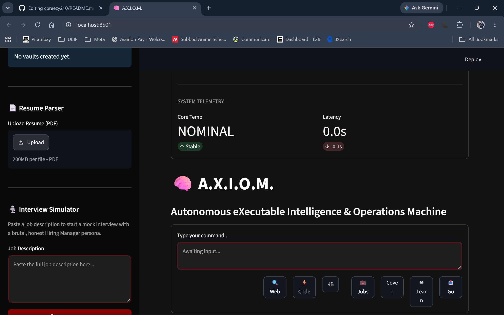
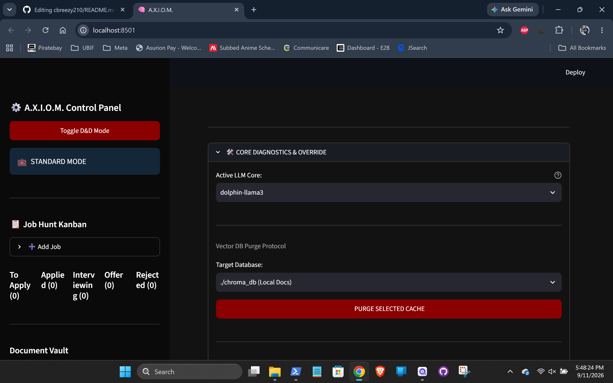
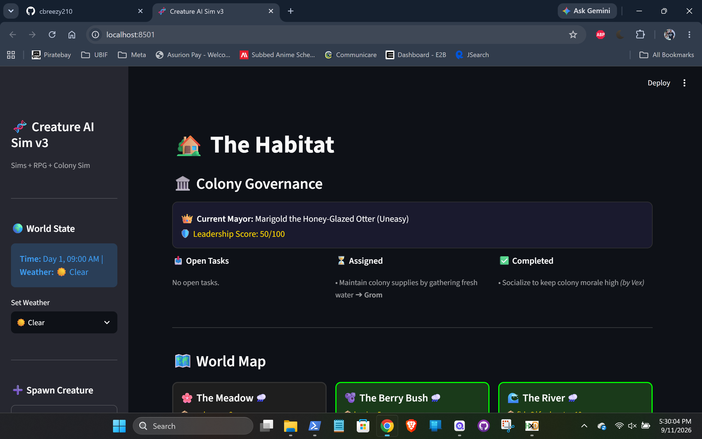

  

# Hi, I'm cbreezy210 (Corrupt Bro) 👋
**Software Developer | Reverse Engineer | Local-First AI Architect**

I build native Nintendo Switch homebrew, zero-dependency save editors, and offline AI systems. My doctrine is simple: byte-verified or it doesn't ship. I maintain a public corrections log, prioritize safety-first engineering, and let the code speak for itself.

<strong>📑 Quick Navigation (Click to Expand)</strong>

 
• <a href="#-impact--metrics">Impact & Metrics</a> 
• <a href="#️-tech-stack">Tech Stack</a> 
• <a href="#-featured-projects">Featured Projects</a> 
• <a href="#-open-source-contributions">Open Source Contributions</a> 
• <a href="#-ai--local-systems">AI & Local Systems</a> 
• <a href="#-from-the-trenches">From the Trenches</a> 
• <a href="#-lets-work-together">Let's Work Together</a>

---

##  Impact & Metrics
- **1,800+ downloads** served across all open-source projects.
- **#1 Post of All Time** on r/SwitchPirates: Atmosphere 1.12.1 announcement (17.8k views, 85 upvotes, 99% upvote ratio, 63 comments, 10 shares).
- **#2 Post of All Time** on r/SwitchPirates: FW 23.0.0 Recovery Guide (26.9k views, 82 shares, 46 comments, 91% upvote ratio) - maintained with a public corrections log and maintainer-verified fixes (bth, hexkyz).
- **Zero lost saves** across 1,000+ installs of ACNH-Save-Editor, thanks to a byte-verified backup + dual-file commit safety pipeline.
- **Global Reach:** Top viewers from United States (42.4%), Canada (8.6%), Germany (11.5%), Brazil (4.3%), and UK (5.5%).

---

## 🛠️ Tech Stack
**Languages:**

   

**Systems & Low-Level:**   -2D3748?style=for-the-badge&logo=linux&logoColor=white)

**AI & Tools:** -8A2BE2?style=for-the-badge&logo=openai&logoColor=white) 

---

## 🚀 Featured Projects

### 🟡 [PKHeX-NX](https://github.com/cbreezy210/PKHeX-NX) 🔴⚪️ *(Active Beta)*
 

**A 100% native Switch save editor for Pokémon Scarlet & Violet.** No PC, no save dumping, no bridges. v0.9.5 QoL sprint live.
- **RE Highlights:** Cracked Gen 9 SCBlock/SCXorShift32 save structure with SHA256 footer verification. Ported PKHeX `SpeciesConverter` to fix Paldean ID divergence. Built a legality-aware generator with real learnsets and growth-correct EXP curves.
- 📖 [GameBrew Wiki](https://www.gamebrew.org/wiki/PKHeX-NX) | 💬 [GBATemp Thread](https://gbatemp.net/threads/homebrew-app-pkhex-nx-native-switch-pokemon-save-editor-scarlet-violet-devlog-sneak-peek.684125/)

### 🟢 [ACNH-Save-Editor](https://github.com/cbreezy210/ACNH-Save-Editor) 🍃 *(Stable)*
 
 

**The first 100% native Switch save editor for Animal Crossing: New Horizons.** v1.4.0 live (1,536+ downloads). v1.5.0 Room Decorations Injector in dev.
- **RE Highlights:** Cracked AES-encrypted economy integers split across `personal.dat` and `main.dat`. Implemented automatic Murmur3 hash healing. Mapped the pocket item table (8-byte slot records at `0x2A00`) powered by a 13,000+ item database.

### 🟡 [TimeStranger-NX](https://github.com/cbreezy210/TimeStranger-NX) 💩 *(Active Dev)*

**The first native Switch save editor for Digimon Story: Time Stranger.** 
- **RE Highlights:** Achieved direct NAND FS access (no bridge required). Located Yen value at offset `0x7973` (u32 LE). Discovered the `fsFsCommit()` requirement to prevent silent NAND rollbacks.

### 🟡 [Fallout: Evolution](https://github.com/rh-hideout/pokeemerald-expansion) *(Collaboration)*
Fallout-themed Pokémon ROM hack led by **abelardthebard**. Contributing creature design, BST/stat balancing, lore-to-mechanics ability mapping, and type-chart optimization. Currently locking in the early-game batch (Dogmeat starter branches, Mutant Hound lines).

---

## 🤝 Open-Source Contributions
- **[r/SwitchPirates 23.0.0 Recovery Guide](https://www.reddit.com/r/SwitchPirates/comments/1wtuu8e/fw_2300_atmosphere_1120_fixed_the_yellow_screen/)**: Authored the definitive troubleshooting guide. Maintained with a public corrections log and maintainer-verified fixes (bth, hexkyz).
- **[OpenNOW-Switch](https://github.com/OpenCloudGaming/OpenNOW-Switch)**: Conducted deep hardware QA. Isolated a DTLS stream negotiation hang, caught a critical global input regression that CI missed, and held the QA block on the native-Switch implementation to document a lifecycle crash before merge.
- **[flamoris-ai-agent](https://github.com/flamoris-jp/flamoris-ai-agent)**: Executed full local acceptance checklist. Identified critical friction points (UTF-8 encoding traps, API mismatches) which directly influenced the maintainer's architectural refactor ([PR #20](https://github.com/flamoris-jp/flamoris-ai-agent/pull/20)).
- **[GitProfileLens](https://github.com/quangshuynh/gitprofilelens)**: Implemented keyboard-accessible copy feedback with `aria-live` announcements and rewrote unit tests to exercise real production handlers.
- **[Dusklight](https://github.com/HayatoG/dusklight)**: Diagnosed a version mismatch between `.nro` NACP metadata and the in-game menu. Proposed three distinct CMake/release pipeline solutions.

---

## 🤖 AI & Local Systems

### A.X.I.O.M. v2 — Autonomous Local AI OS

  
  

<em>Left: Resume Parser + Brutal Interview Simulator | Right: Job Hunt Kanban Tracker</em>

- 🐉 **Uncensored Dungeon Master:** Persistent world state, combat tracking, lore RAG, session chronicles.
- 💼 **Brutal Interview Simulator:** Realistic hiring manager persona with scored feedback.
- 🛠️ **PC Diagnostic Agent:** Executes local PowerShell tools safely via permission gate.
- 🧠 **Fully Offline:** Runs on Ollama + ChromaDB. Zero data leaves the machine.

### Creature_AI_Prototype — Multi-Agent Ecosystem

  

<em>Emergent colony governance with elected mayors, task delegation, and persistent creature relationships</em>

- 🧠 **Persistent Individual Minds:** Unique memory, personality, and relationship maps per agent.
- 🏛️ **Elected Governance:** Dynamic mayor elections with leadership scores and task assignment.

## 🧰 Developer Tools

### 🟢 [gh-network-scanner](https://github.com/cbreezy210/gh-network-scanner) 🕸️ *(Stable)*
  
**A zero-dependency, safety-first CLI that maps your second-degree GitHub network to surface high-signal developers.** Pure Python stdlib — no pip, no frameworks.
- **Smart Quality Gate:** Automatically filters out bots, mass-followers (>800 following), and empty accounts (<3 repos) to find true domain experts.
- **Real-World Proof:** Used this exact tool to discover and connect with Switch homebrew legends (ClusterM, fincs, WinterMute) and local-AI architects.

---

## 💬 From the Trenches
See what the community and collaborators are saying about my work in [TESTIMONIALS.md](TESTIMONIALS.md).

> *"Your Phase 0 feedback helped us catch exactly the kind of portability issues we wanted to eliminate."*  
> — **akino-nanto**, flamoris-ai-agent maintainer *(on PR #20)*

> *"I told my niece I corrupted her island... she dubbed you 'Corrupt Bro'. Restoring the Zelda save sounds complicated so I think I'm going to stop but I'm happy the switch is working again. Again, you're an awesome person for taking the time to help me troubleshoot."*  
> — **igomhn3**, ACNH-Save-Editor User *(after a successful NAND rescue)*

> *"Thanks for the heads up on the dvr patches. I don't have any reason to update my emummc right now but when I do update it and my games crash, I'll know why"*  
> — **SwellEquis**, r/SwitchPirates *(preventative harm reduction working in the wild)*
---

## 💼 Let's Work Together
I leverage deep expertise in reverse engineering, systems programming, and local AI architecture to solve complex technical challenges. I prioritize safety, transparency, and byte-verified integrity.

- **✍️ Technical Writing:** Translating low-level concepts into actionable guides (e.g., the 26.9k+ view r/SwitchPirates recovery guide).
- **🐛 Security Auditing & QA:** Finding edge cases CI misses. Focused on memory safety, crypto implementations, and Horizon OS crash-screen decoding.
- **🛠️ Systems Engineering:** Building zero-dependency diagnostic agents for secure, offline workflows.

📩 **Contact:** [christopherbrownii1993@gmail.com](mailto:christopherbrownii1993@gmail.com)  
🌐 **Connect:** [Bluesky](https://bsky.app/profile/cbreezy210.bsky.social) | [GBATemp](https://gbatemp.net/members/cbreezy210.619217/) | [GameBanana](https://gamebanana.com/members/5799686)

---

### 💖 Support This Work
I build native Switch homebrew, zero-dependency save editors, and local-first AI systems. All my tools are open-source, safety-first, and byte-verified. If you've benefited from my work, your support helps me keep building tools you can trust.

  

---

  
    
  

